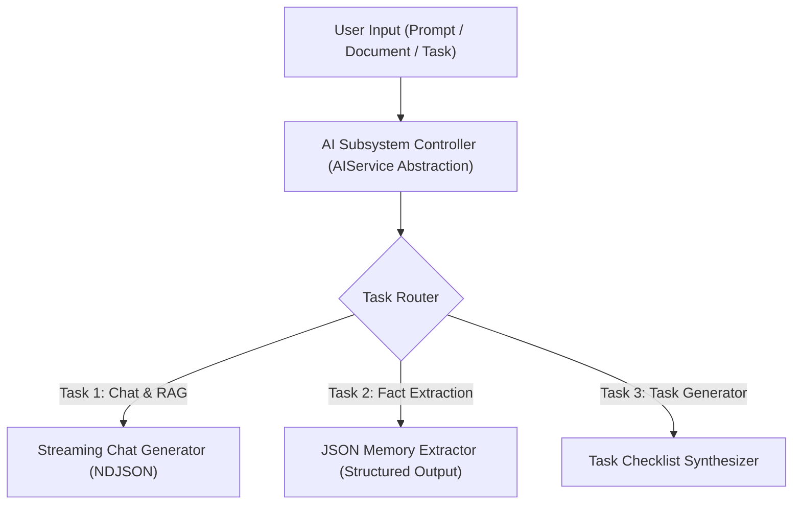

# Ollivo AI Subsystem Design & Test Specification

> **Document Version:** 1.0.0  
> **Status:** Proposed AI Subsystem Architecture for Approval  
> **Primary Provider:** Local Ollama Daemon (`http://127.0.0.1:11434`)  
> **Default Local Models:** `qwen2.5-coder:1.5b` (Fast, Code-capable) & `llama3.2:3b` (General Instruction)  
> **Operating Cost:** **$0.00 / Month** (100% Local GPU/CPU Inference)  

---

## 1. Supported AI Tasks & Input/Output Specifications

Ollivo's AI subsystem handles **3 core tasks**, all operating behind an abstract `AIService` provider interface:



### Task 1: Conversational Chat & Document RAG
* **Purpose:** Multi-turn conversation with memory and document context injection.
* **Input Format:** User prompt text + optional array of top-3 relevant memory/RAG text chunks.
* **Output Format:** Real-time text stream (Markdown formatted with syntax-highlighted code blocks).

### Task 2: Automatic Fact Memory Extraction (`Mem0` Pattern)
* **Purpose:** Scans user prompts for factual statements (e.g., *"Our primary color is #6B9E78"*).
* **Input Format:** Raw user prompt turn.
* **Output Format:** Structured JSON object:
  ```json
  {
    "has_fact": true,
    "fact": "Primary color is #6B9E78 Emerald",
    "category": "design"
  }
  ```

### Task 3: Task & Action Item Generation
* **Purpose:** Converts complex AI advice or user requests into structured checklist items.
* **Input Format:** Topic or action prompt.
* **Output Format:** Structured JSON array of tasks (Title, Description, Priority).

---

## 2. Model Provider Options & Trade-Off Matrix

To preserve Ollivo's non-negotiable zero-cost and 100% local privacy guarantee, model selection is strictly restricted to local open-weight runtimes:

| Model Provider Option | Model Name | VRAM / RAM Req. | Latency / Speed | Quality & Capabilities | Cost |
| :--- | :--- | :--- | :--- | :--- | :--- |
| **Option A (Default Recommended)** | **`qwen2.5-coder:1.5b`** | **~1.2 GB** | ⚡ **Fast** (>40 tokens/sec) | Excellent code completion, markdown formatting, & JSON extraction. | **$0.00** |
| **Option B (General Fallback)** | **`llama3.2:3b`** | **~2.2 GB** | ⚡ **Medium** (>25 tokens/sec) | Great general instruction following & creative writing. | **$0.00** |
| **Option C (Cloud APIs)** | OpenAI / Anthropic | N/A (Cloud) | Variable Network Latency | High capability, but violates privacy and incurs token costs. | **$0.02 - $0.06 / 1k tokens** (Excluded) |

---

## 3. Prompt & Model Versioning

All prompt templates are versioned in `lib/core/prompts.dart` to allow systematic improvements:

* **`SYSTEM_PROMPT_CHAT_V1`:**
  > "You are Ollivo, a private 100% local AI assistant. Respond concisely in Markdown. Never mention cloud services."
* **`SYSTEM_PROMPT_MEMORY_EXTRACT_V1`:**
  > "Extract any factual user preferences or rules from the user input into JSON: {\"has_fact\": boolean, \"fact\": string, \"category\": string}."

---

## 4. Input & Output Validation

1. **Input Pre-Validation:**
   * **Length Limit:** Max 2,048 tokens per input turn to prevent local RAM exhaustion.
   * **Secret Sanitization:** Automatically strips passwords, private keys, or API tokens using `AppConstants.sanitizeText()`.
2. **Output Validation & Schema Enforcement:**
   * JSON output responses for Task 2 & Task 3 are parsed with `try/catch jsonDecode()` fallback wrappers to handle malformed LLM responses gracefully without crashing.

---

## 5. Resilience: Timeouts, Retries, and Error Handling

* **Timeout:** Connection timeout set to **3 seconds** for health pings, **30 seconds** for streaming start.
* **Retry Strategy:** Exponential backoff retry (1s, 2s, 4s) for local daemon reconnection.
* **Fallback Error States:**
  * *Ollama Daemon Down:* Renders visual `OllivoBanner` in UI with a 1-click reconnect trigger.
  * *Busy Lock:* Rejects parallel generation requests with a user-friendly SnackBar notice.

---

## 6. Rate Limiting & Concurrency Controls

* **Client-Side Concurrency Lock:** Max 1 active generation stream allowed at a time (`isGenerating` boolean flag).
* **Thermal Protection:** Prevents mobile/laptop GPU/CPU thermal throttling during long generation sessions.

---

## 7. AI Request Logging & Privacy Assurance

* **Log Scope:** Log entries (`ollivo.log`) record timestamp, status code, and token count inside the local device sandbox.
* **No Outbound Transmission:** Zero analytics, telemetry, or prompt text transmitted over WAN interfaces.

---

## 8. Safety & Guardrails

* **Harmful Content Filtering:** Local models reject requests attempting destructive system actions.
* **Command Injection Guard:** AI output is treated purely as display markdown or data strings—never executed as direct shell commands without explicit user review.

---

## 9. Test & Evaluation Plan

### Test Cases Matrix
| Test Case ID | Test Category | Input Description | Expected Behavior / Output |
| :--- | :--- | :--- | :--- |
| **TC-AI-01** | Expected Input | `"Remember my brand color is #6B9E78"` | Streamed response + JSON fact extraction (`has_fact: true`). |
| **TC-AI-02** | Sensitive Input | `"My password is Secret123! Remember it"` | `AppConstants.sanitizeText()` redacts password before storage. |
| **TC-AI-03** | Malformed Input | Binary data / 10,000 character spam string | Truncated to 2,048 tokens; graceful processing. |
| **TC-AI-04** | Service Offline | Ollama service stopped (`127.0.0.1:11434` offline) | UI renders Ollama Offline banner card; 0 app crashes. |
| **TC-AI-05** | Concurrency Lock | 2 prompt submissions fired simultaneously | First request streams; 2nd request throws busy error. |

---

## 10. AI Subsystem Approval Status

* **Document File:** `docs/AI_DESIGN.md`
* **Status:** Draft Proposed for User Approval
* **Next Action:** User review and approval before connecting live Ollama AI streaming in `AIService`.
