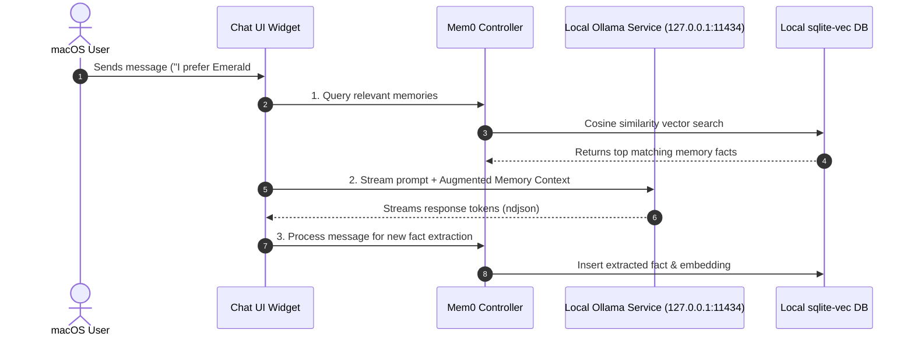

# Ollivo Detailed System Architecture & Technical Design (macOS Desktop)

> **Document Version:** 3.0.0  
> **Status:** Approved Strategy & Technical Architecture  
> **Target Platform:** macOS Desktop Application ONLY  
> **Core Architecture:** 100% Local-First AI, $0 Operating Cost, Zero Cloud Data Transmission  

---

## 1. High-Level System Architecture

Ollivo is built on a **100% Local-First macOS Desktop Client Architecture**. All database transactions, AI inference calls, vector similarity searches, and document processing happen directly inside the macOS application sandbox or over the local loopback interface (`127.0.0.1`).

```mermaid
graph TD
    subgraph macOS Application Sandbox (Flutter Desktop UI & Core Services)
        UI["Flutter Presentation Layer (Desktop Sidebar / Chat / Memories / Docs / Tasks)"]
        State["Controller Layer (ChatController & App State)"]
        
        subgraph Local Core Services
            AIService["Ollama AI REST Connector"]
            MemService["Mem0 Vector Memory Engine"]
            RAGService["Document Indexer & RAG Engine"]
            TaskService["Task Manager Service"]
        end
        
        subgraph macOS Sandbox Storage (~/Library/Application Support/com.ollivo.app/)
            SQLite["SQLite Database (ollivo.db)"]
            VecDB["sqlite-vec (Vector Embeddings)"]
            DocSandbox["Local Document Storage (/documents)"]
        end
    end

    subgraph Local Host Machine (macOS Operating System)
        OllamaService["Local Ollama Daemon (127.0.0.1:11434)"]
        LocalLLM["Local LLM Model (qwen2.5-coder / llama3.2 with Metal Acceleration)"]
        NativemacOS["AppKit / Cocoa Window Manager & Menu Bar Extra"]
    end

    UI --> State
    NativemacOS --> UI
    State --> AIService
    State --> MemService
    State --> RAGService
    State --> TaskService

    AIService -->|HTTP REST / NDJSON Stream| OllamaService
    OllamaService --> LocalLLM

    MemService --> VecDB
    RAGService --> VecDB
    RAGService --> DocSandbox
    TaskService --> SQLite
    VecDB --> SQLite
```

---

## 2. Component Explanations (Beginner-Friendly)

* **Flutter macOS Presentation Layer:** The desktop interface that renders the sidebar, chat workspace, memory audit cards, and task lists natively on macOS with Metal hardware acceleration.
* **Ollama AI Connector:** The internal communications bridge that sends user prompts to the local Ollama AI model running on the Mac (`127.0.0.1:11434`) and streams back text word-by-word.
* **Mem0 Vector Memory Engine:** An intelligent local background worker that listens to conversations, extracts key facts (e.g., design choices or project tech stack preferences), and stores them in local vector storage so Ollivo remembers them in future chats.
* **Document Indexer & RAG Engine:** Reads local text and markdown files dragged into Ollivo from Finder, breaks them into small paragraphs, calculates mathematical vector representations, and enables semantic search over personal notes.
* **SQLite + `sqlite-vec` Database:** A fast, self-contained database stored inside the macOS application sandbox (`~/Library/Application Support/com.ollivo.app/ollivo.db`). It holds chat logs, task lists, and vector embeddings without any internet connection.

---

## 3. Detailed Architectural Specifications

### 3.1 macOS Sandbox & Storage Paths
* **Database Path:** `~/Library/Application Support/com.ollivo.app/ollivo.db`
* **Documents Directory:** `~/Library/Application Support/com.ollivo.app/documents/`
* **Application Log File:** `~/Library/Application Support/com.ollivo.app/logs/ollivo.log`

### 3.2 AI Request & Response Streaming Flow


### 3.3 Permissions & macOS Sandbox Compliance
* **File Access:** Scoped to user-selected files via macOS File Picker or Finder drag-and-drop.
* **Network Boundaries:** Scoped strictly to `127.0.0.1` (loopback) for local Ollama communication.
* **Zero External Telemetry:** No network calls made to external internet servers.

### 3.4 Rate Limits & Concurrency Controls
* **Concurrency Lock:** Maximum 1 active LLM generation request at a time to prevent thermal throttling on Apple Silicon / Intel processors.
* **Context Token Capping:** Prompt token window capped at `2,048` tokens to optimize local RAM/VRAM usage.

---

## 4. Implementation Status & Feature Roadmap

| Feature Layer | Implemented / Verified | Planned macOS Enhancements |
| :--- | :--- | :--- |
| **AI Chat & Streaming** | ✅ Ollama REST streaming connector (`127.0.0.1:11434`), markdown rendering, secret sanitization regex. | 📋 macOS `⌘+N` shortcut, quick prompt launcher. |
| **Local Memory & DB** | ✅ SQLite database schema (`ollivo.db`), `Mem0` fact extraction, vector service backend. | 📋 Visual memory card editor UI & tag manager. |
| **Design & Shell** | ✅ Onyx (`#121212`) & Emerald (`#6B9E78`) tokens, desktop sidebar shell, 9 foundation components. | 📋 Native macOS menu bar extra status item, window bounds persistence. |
| **Quality & Tests** | ✅ 14/14 automated unit & widget tests passing (`flutter test`), 0 static analysis errors. | 📋 Integration test suite for macOS binary packaging. |

---

## 5. Developer Tooling & Xcode Prerequisites

To compile and package native macOS desktop release binaries (`ollivo.app`), Xcode Command Line Tools must point to full Xcode:

```bash
# Required developer environment configuration (Manual setup):
sudo xcode-select -switch /Applications/Xcode.app
```

---

## 6. Architectural Approval & Status

* **Author:** Lead Systems Architect
* **Status:** Approved Strategy & Technical Architecture (Flutter macOS Desktop)
