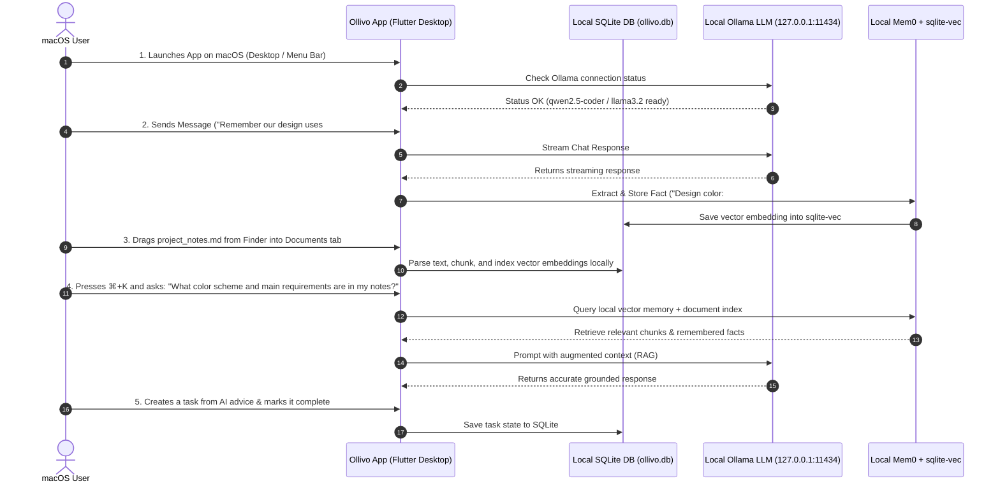

# Ollivo Minimum Viable Product (MVP) Scope (macOS Desktop)

> **Document Version:** 2.0.0  
> **Status:** Approved Strategy & Scope Specification  
> **Target Platform:** macOS Desktop Application ONLY  
> **Primary Technology:** Flutter & Dart (Native macOS Target)  
> **Core Focus:** 100% Local-First AI Chat, Persistent Fact Memory, Document RAG, and Task Management  

---

## 1. Primary User Journey (macOS Desktop)



---

## 2. Essential Features (Ordered by Priority)

| Priority | Feature | Description | Status / Deliverable |
| :--- | :--- | :--- | :--- |
| **P0** | **Local Model Connector & AI Chat** | Connects to Ollama host (`127.0.0.1:11434`) over HTTP REST for offline streaming chat with markdown & code syntax highlighting. | ✅ **Implemented** (Verified multi-turn chat UI). |
| **P0** | **Persistent Fact Memory System** | Automatically extracts facts from user chat and stores them in local SQLite + `sqlite-vec` vector storage (`Mem0` pattern). | ✅ **Implemented** (Verified backend & service tests). |
| **P0** | **Ollivo Design Tokens & macOS App Shell** | Desktop UI adhering to Onyx (`#121212`), Emerald (`#6B9E78`), and White theme tokens with permanent multi-column sidebar split view. | ✅ **Implemented** (Desktop sidebar shell & design system). |
| **P1** | **Memory Management Center** | Visual screen displaying all stored memory entries with search, tag filtering, manual edit, and single-click deletion. | 🟡 **UI Shell Active** (Backend ready; full visual manager planned). |
| **P1** | **macOS Document Import & Local RAG** | Finder drag-and-drop / file picker for `.md`, `.txt`, and code files. Chunks text, computes embeddings, and performs semantic search. | 🟡 **UI Shell Active** (Parser & vector search implementation planned). |
| **P2** | **macOS Task Workspace** | Local task manager to create, track, filter (All, Active, Completed), and check off to-dos generated manually or by AI. | 🟡 **UI Shell Active** (SQLite schema ready; CRUD integration planned). |
| **P2** | **macOS System Integrations** | macOS Menu Bar extra status item, global hotkeys (`⌘+K`, `⌘+N`), window bounds persistence. | 📋 **Planned** (Native desktop capabilities). |

---

## 3. Features Postponed / Excluded from Roadmap

* ❌ **Web Application & PWA Runtimes:** Excluded to maintain 100% focus on macOS desktop capabilities.
* ❌ **Android & iOS Apps:** Excluded from active product roadmap.
* ❌ **Cloud Sync & Remote Backup:** Excluded to preserve 100% local privacy and zero server costs.
* ❌ **Cloud LLM Providers (OpenAI, Anthropic, Gemini Cloud):** Excluded to enforce local-first guarantees.
* ❌ **Paid User Subscriptions & Licensing Servers:** Excluded; Ollivo is 100% free open-source software.

---

## 4. Desktop Interface Architecture

```
┌────────────────────────────────────────────────────────────────────────┐
│                        Ollivo macOS Window Shell                       │
│  ┌─────────────────┬────────────────────────────────────────────────┐  │
│  │ Navigation      │ Main Content View Pane                         │  │
│  │ Sidebar         │                                                │  │
│  │                 │ ┌────────────────────────────────────────────┐ │  │
│  │  💬 AI Chat     │ │ Active Screen                              │ │  │
│  │  🧠 Memories    │ │ (AI Chat / Memory Center / Docs / Tasks)   │ │  │
│  │  📄 Documents   │ │                                            │ │  │
│  │  ✅ Tasks       │ │                                            │ │  │
│  │  ⚙️ Settings    │ └────────────────────────────────────────────┘ │  │
│  │                 │                                                │  │
│  └─────────────────┴────────────────────────────────────────────────┘  │
└────────────────────────────────────────────────────────────────────────┘
```

1. **AI Chat Workspace (`/chat`):**
   * **Purpose:** Primary interface for conversing with the local LLM.
   * **Key Components:** Streaming message list, markdown code blocks, input bar, model selector dropdown, Ollama connectivity status pill.
2. **Memory Management Center (`/memories`):**
   * **Purpose:** Audit and manage all facts Ollivo has remembered about the user.
   * **Key Components:** Search bar, memory card list, timestamp badges, "Forget Fact" delete action, "Clear All Memories" button.
3. **Documents & Local RAG Screen (`/documents`):**
   * **Purpose:** Import personal text files for offline document interrogation via Finder drag-and-drop.
   * **Key Components:** Finder drop zone / picker button, indexed files table, chunk count badges, document search preview.
4. **Task Workspace (`/tasks`):**
   * **Purpose:** Organize to-dos and action items.
   * **Key Components:** Quick task input field, category tags, priority indicators (Low, Medium, High), status checkboxes, filter tabs.
5. **Settings & Diagnostics Screen (`/settings`):**
   * **Purpose:** Configure local environment and check system health.
   * **Key Components:** Ollama Host URL configuration field, active model display, SQLite database disk usage readout.

---

## 5. macOS Desktop Definition of Done (DoD)

A feature is considered **Done** only when:
1. **Compilation:** Compiles cleanly for macOS target without errors or warnings (`flutter analyze`).
2. **Automated Testing:** Unit and widget tests pass (`flutter test`).
3. **Local Privacy:** Verified 0 network packets sent to external public internet servers during feature usage.
4. **Design Token Conformance:** Uses exact brand colors (`#121212` Onyx background, `#6B9E78` Emerald primary, `#FFFFFF` text).
5. **macOS Integration:** Functions with native desktop windowing and keyboard shortcuts.
6. **Persistence:** Data persists cleanly in `~/Library/Application Support/com.ollivo.app/ollivo.db` across application restarts.

---

## 6. Build Prerequisites & System Requirements

* **Operating System:** macOS 12.0 (Monterey) or newer (Apple Silicon M1/M2/M3/M4 or Intel x86_64).
* **Local Inference Engine:** Ollama installed and running (`127.0.0.1:11434`).
* **Developer Build Toolchain:** Xcode Command Line Tools pointed to full Xcode (`sudo xcode-select -switch /Applications/Xcode.app`).

---

## 7. Scope Approval Status

* **Author:** Lead Systems Architect & Product Manager
* **Status:** Approved Strategy & Scope Specification (Flutter macOS Desktop)
