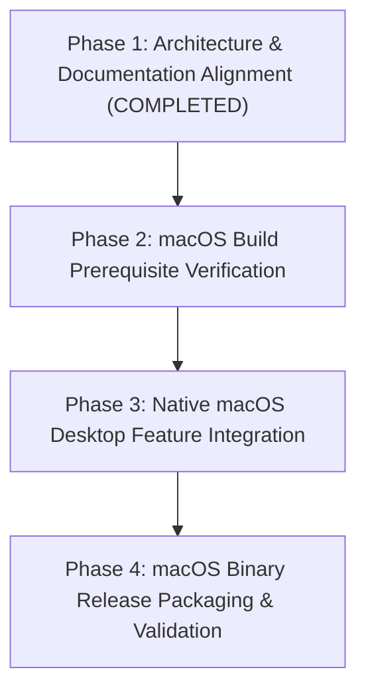

# Ollivo Native macOS Desktop Migration & Implementation Plan

> **Document Version:** 1.0.0  
> **Status:** Approved Strategy & Implementation Plan  
> **Target Platform:** macOS Desktop Application ONLY  
> **Primary Technology:** Flutter & Dart (Native macOS Target)  
> **Core Objective:** Deliver a 100% Local-First macOS Desktop Assistant while preserving all existing codebase assets and passing tests.

---

## 1. Plan Overview & Key Principles

1. **Preserve All Existing Work:** Retain 100% of the existing Dart source code (`lib/` - 10 source files, 2,346 lines) and automated test suite (`test/` - 14/14 tests passing).
2. **Focus Exclusively on macOS Desktop:** Optimize layout, navigation, desktop windowing, keyboard shortcuts, and menu bar extra planning for macOS.
3. **No Automatic System Modifications:** Document the Xcode developer tools prerequisite (`sudo xcode-select -switch /Applications/Xcode.app`) clearly for developer execution prior to binary release packaging.
4. **No Global Flutter Config Alterations:** Exclude web, Android, and iOS targets from the active product roadmap without invoking global SDK configuration changes.

---

## 2. Implementation Phase Roadmap



### Phase 1: Architecture & Documentation Alignment (Completed)
- [x] Conduct empirical workspace inspection of source files, dependencies, and test suite.
- [x] Verify test suite health (`14/14` tests passing via `flutter test`).
- [x] Verify static code analysis (`0` errors, `0` warnings via `flutter analyze`).
- [x] Update core documentation (`PRODUCT_BRIEF.md`, `MVP_SCOPE.md`, `TECH_STACK.md`, `ARCHITECTURE.md`).

### Phase 2: macOS Build Prerequisite Verification
- [ ] Developer manually verifies full Xcode installation (`/Applications/Xcode.app`).
- [ ] Developer executes developer directory switch: `sudo xcode-select -switch /Applications/Xcode.app`.
- [ ] Execute `flutter build macos` to verify native macOS binary compilation (`ollivo.app`).

### Phase 3: Native macOS Desktop Feature Integration
- [ ] **macOS Window Controls & State:** Implement window size persistence and minimum window constraints (`1024x720`).
- [ ] **macOS Global Shortcuts:** Wire `⌘+N` (New Chat), `⌘+K` (Search), and `⌘+Shift+M` (Memory Center).
- [ ] **macOS Drag & Drop File Parsing:** Implement Finder drag-and-drop file ingestion into `/documents` view.
- [ ] **macOS Menu Bar Companion:** Plan and integrate status item menu bar extra for quick access.

### Phase 4: macOS Binary Release Packaging & Validation
- [ ] Execute release build: `flutter build macos --release`.
- [ ] Verify packaged `.app` bundle at `build/macos/Build/Products/Release/ollivo.app`.
- [ ] Perform offline user acceptance testing and record release metrics in `docs/RELEASE_READINESS.md`.

---

## 3. Detailed Build Prerequisite Instructions

```bash
# Step 1: Check active developer directory
xcode-select -p

# Step 2: Switch to full Xcode installation (Required for xcodebuild native macOS compilation)
sudo xcode-select -switch /Applications/Xcode.app

# Step 3: Verify xcodebuild target SDK
xcodebuild -version
```

---

## 4. Feature Status Matrix

| Component | Implemented | Planned for macOS Desktop Phase |
| :--- | :--- | :--- |
| **Ollama Streaming REST Engine** | ✅ Yes (`127.0.0.1:11434`) | — |
| **SQLite & Vector Memory Backend** | ✅ Yes (`ollivo.db`) | — |
| **Design Tokens & Sidebar Shell** | ✅ Yes (`#121212` Onyx / `#6B9E78` Emerald) | — |
| **Automated Test Suite** | ✅ Yes (`14/14` tests passing) | — |
| **macOS Window Controls & State** | ❌ No | 📋 Phase 3 |
| **macOS Global Hotkeys** | ❌ No | 📋 Phase 3 |
| **macOS Finder Drag-and-Drop** | ❌ No | 📋 Phase 3 |
| **macOS Menu Bar Companion** | ❌ No | 📋 Phase 3 |

---

## 5. Document Approval & Status

* **Author:** Lead Systems Architect
* **Status:** Approved Strategy & Migration Plan (Flutter macOS Desktop)
