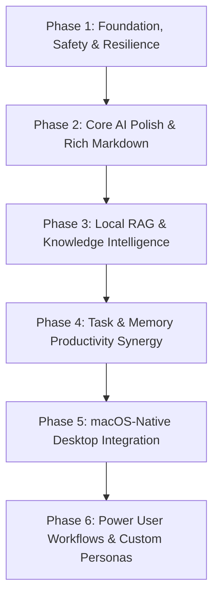

# Ollivo — Product Improvement Roadmap

## Strategic Vision
Transform **Ollivo** from a functional local AI client into the premier private AI desktop experience on macOS — combining the privacy guarantees of air-gapped local execution with the speed, fluid aesthetics, and native ergonomics expected of top-tier Mac applications like Raycast, Obsidian, and Bear.

---

## Phased Master Roadmap

---

### Phase 1: Foundation, Safety & Resilience (P0)

**Focus**: Ironclad reliability, zero crashes, robust error handling, database backup/recovery.

- **Features Included**:
  - `MOD-002`: One-Click Ollama Daemon Launcher / Restarter.
  - `CORE-008`: Auto-Scroll Pin / Unpin on User Upward Scroll.
  - `SET-002`: Complete Backup & Restore to Encrypted ZIP Archive.
  - `MAC-003`: Native macOS Application Menu Bar (`File`, `Edit`, `Window`, `Help`).
  - `UI-004`: Keyboard-First Focus Navigation (`Tab`, `Escape`, `Enter`).

- **Expected Outcomes**:
  - The app never hangs or fails silently when Ollama is offline.
  - Users can backup and restore all SQLite databases, memories, documents, and tasks with 1 click.
  - Standard macOS menus work properly.

- **Definition of Done**:
  - 100% passing automated tests for process spawning, backup creation, and database recovery.
  - App passes stress tests with simulated network disconnects and abrupt application quits.

---

### Phase 2: Core AI Polish & Rich Markdown (P0 & P1)

**Focus**: Reading comfort, code usability, performance transparency.

- **Features Included**:
  - `CORE-001`: Rich Markdown & Code Syntax Highlighting with Copy Button.
  - `CORE-004`: Prompt Token Counter & Speed (tok/s) Telemetry.
  - `CORE-009`: Copy Code Block with Language Pill & Copied Feedback.
  - `CORE-010`: Prompt Input Auto-Expand & Max-Height Scroll.
  - `MOD-005`: Active Model Quick-Switcher in Top Bar.
  - `UI-003`: Custom Monospace Font for Code Blocks (JetBrains Mono).

- **Expected Outcomes**:
  - Code blocks render beautifully with language indicators and 1-click clipboard copy.
  - Generation speed (tokens per second) and token counts are transparently shown.
  - Users can switch active models directly from the top bar without navigating to Settings.

- **Definition of Done**:
  - Markdown widget tests pass for multiline code blocks, tables, LaTeX math, and quotes.
  - Input box expands dynamically up to 6 lines before scrolling.

---

### Phase 3: Local RAG & Knowledge Intelligence (P1)

**Focus**: Seamless document ingestion, semantic search, and grounded citations.

- **Features Included**:
  - `DOC-001`: Local Vector Embeddings via Ollama `/api/embeddings` (`nomic-embed-text`).
  - `DOC-002`: Native PDF & DOCX Text Extraction.
  - `DOC-003`: Interactive Source Citations in Chat Responses.
  - `DOC-006`: Drag-and-Drop File Import Zone.
  - `DOC-007`: Multi-Page Document Ingestion Progress Bar.

- **Expected Outcomes**:
  - Users can drag PDFs, DOCX, and text files directly into the window.
  - Ollivo performs hybrid dense vector + sparse TF-IDF retrieval for RAG.
  - Assistant answers display clickable citations that preview the source excerpt.

- **Definition of Done**:
  - 100-page PDF processes in the background with a visible progress bar.
  - Semantic query returns matching chunks even when phrasing differs from the text.

---

### Phase 4: Task & Memory Productivity Synergy (P1 & P2)

**Focus**: Connecting AI chat conversations to actionable tasks and long-term memory.

- **Features Included**:
  - `TSK-001`: Natural Language Chat-to-Task Parser.
  - `TSK-002`: Due Date Native Calendar Picker.
  - `TSK-006`: One-Click Task Context Insertion in Chat.
  - `MEM-001`: Memory Categorization & Tag Filter.
  - `MEM-002`: Inline Memory Editing & Correction Modal.
  - `MEM-003`: Semantic Deduplication on Memory Save.

- **Expected Outcomes**:
  - One-click extraction of tasks from AI chat suggestions.
  - Users can view, filter, and edit extracted memories easily.
  - Redundant facts are automatically merged instead of creating duplicate records.

- **Definition of Done**:
  - Task and memory integration tests verify end-to-end SQLite persistence and UI updates.

---

### Phase 5: macOS-Native Desktop Integration (P1 & P2)

**Focus**: Native desktop workflows, global access, and Mac ergonomics.

- **Features Included**:
  - `MAC-001`: Global Spotlight-Style Quick Ask Window (`⌘+Shift+Space`).
  - `MAC-002`: Menu Bar Extra (Tray Icon with Mini Popover).
  - `MAC-004`: Window Position & Dimension Restoration Across Launches.
  - `MAC-005`: Native File Drag-and-Drop Anywhere in Window.
  - `UI-001`: Fluid Multi-Pane Collapsible Sidebar.

- **Expected Outcomes**:
  - Users can summon Ollivo from anywhere in macOS using a global hotkey.
  - Ollivo remembers window geometry and sidebar collapse state across app restarts.

- **Definition of Done**:
  - Hotkey listener runs reliably without foregrounding delays.
  - Window state restores exactly across app termination and reboot.

---

### Phase 6: Power User Workflows & Custom Personas (P2 & P3)

**Focus**: Advanced customization, specialized personas, and export tooling.

- **Features Included**:
  - `SET-001`: Custom System Instructions / Persona Editor (Coder, Writer, Researcher).
  - `SET-006`: Model Context Window (`num_ctx`) Slider.
  - `CORE-002`: Unified Conversation Search & Filter (`⌘+F`).
  - `CORE-006`: Chat Export (Markdown, PDF, JSON).
  - `MOD-001`: VRAM & Unified Memory Estimation Badge.
  - `MOD-004`: Model Parameters & Modelfile Inspector.

- **Expected Outcomes**:
  - Users can configure custom personas with persistent system prompts.
  - Conversations can be exported cleanly to Markdown or JSON.
  - Power users can tune context window size and inspect model quantizations.

- **Definition of Done**:
  - Persona switching applies custom system prompts to subsequent chat queries.
  - Exported Markdown files contain clean message timestamps and formatting.
