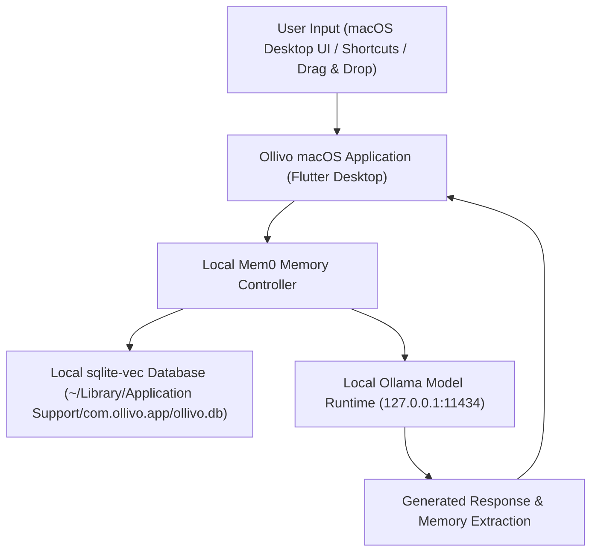

# Ollivo Product Brief & Technical Requirements Document (PRD)

> **Document Version:** 2.0.0  
> **Status:** Approved Strategy & Technical Requirement  
> **Target Platform:** macOS Desktop Application ONLY  
> **Primary Technology:** Flutter & Dart (Native macOS Desktop Target)  
> **Core Architecture:** 100% Local-First AI (Ollama + Mem0 + sqlite-vec + SQLite)  

---

## 1. Product Vision & Summary

### One-Sentence Description
**Ollivo** is a 100% local-first, privacy-focused AI personal assistant and productivity desktop application for macOS that organizes your thoughts, documents, and tasks with intelligent, persistent local memory—without ever sending your data to the cloud.

### Product Vision
To empower privacy-conscious professionals, developers, and knowledge workers on macOS with a native desktop AI assistant that operates entirely on-device, retains long-term context across sessions, and delivers instant, zero-cost productivity tools without cloud subscriptions or data leaks.

---

## 2. Problem Statement

1. **Privacy & Data Security Risks:** Cloud-based AI assistants (ChatGPT, Claude) send private notes, code snippets, and confidential documents to external servers, exposing users to data leaks, corporate surveillance, and model training on private data.
2. **Subscription Fatigue & API Costs:** Most AI productivity applications require recurring monthly subscriptions or expensive token-based API meters.
3. **Fragmented Memory & Context Loss:** Existing chat assistants forget context between sessions, forcing users to repeatedly re-explain project constraints, preferences, and guidelines.
4. **Generic Web Wrapper UX:** Many desktop AI tools are simple web apps stretched onto desktop frames, lacking native macOS shortcuts, desktop window controls, drag-and-drop integration, and menu bar quick access.

---

## 3. Target User Personas & Needs

### Primary Personas
* **Privacy-Conscious macOS Professional:** Needs an intelligent assistant for drafting, organizing notes, and managing tasks on their Mac, but strictly forbidden from uploading work assets to third-party cloud LLMs.
* **Developer & Student on macOS:** Needs code snippet explanation, document summarization, and task tracking with persistent memory of tech stack choices, project guidelines, and macOS workflow integrations.
* **Knowledge Worker:** Needs local semantic search over notes, personal wikis, and project logs directly from their macOS desktop workspace.

### User Needs Matrix
| User Need | How Ollivo Solves It |
| :--- | :--- |
| **Total Privacy** | 100% Local-First AI inference (Ollama) & local vector memory (`sqlite-vec`). No cloud APIs or network leaks. |
| **Zero Operating Costs** | Completely free and open-source foundation; no monthly subscription fees or token costs. |
| **Persistent Context** | Memory engine (`Mem0` + local SQLite) automatically remembers facts, decisions, and preferences. |
| **Native macOS Experience** | Built with Flutter for macOS desktop with multi-column split view, custom dark theme, keyboard shortcuts, and menu bar extra planning. |

---

## 4. Main User Journeys

### User Journey 1: Natural Conversation with Persistent Memory
1. User opens Ollivo from macOS Applications or Menu Bar.
2. User chats with Ollivo: *"Remember that my Flutter project uses 16px corner radius and dark onyx background."*
3. Ollivo acknowledges and stores the decision in local memory (`Mem0` + `sqlite-vec`).
4. Two weeks later, user asks: *"What spacing and background standards did we decide on?"*
5. Ollivo instantly queries local vector memory and returns the exact decision without cloud network calls.

### User Journey 2: macOS Drag & Drop Document Summarization (Local RAG)
1. User drags a text/markdown file or project notes from macOS Finder directly into Ollivo.
2. Ollivo parses and indexes the document locally into `sqlite-vec`.
3. User asks: *"Summarize the main requirements from my notes."*
4. Ollivo generates a precise summary locally using the on-device Ollama model.

### User Journey 3: macOS Task & Action Management
1. User asks Ollivo to create a task list for their launch.
2. Ollivo categorizes items into actionable tasks with priorities.
3. Tasks are stored in local SQLite database (`ollivo.db`) and displayed in a responsive desktop layout.

---

## 5. Core AI Architecture (100% Local-First macOS Desktop)



* **Local LLM Engine:** Ollama (`qwen2.5-coder:1.5b` or `llama3.2:3b`) running on `127.0.0.1:11434` with Apple Silicon Metal acceleration.
* **Persistent Memory Engine:** `Mem0` pattern initialized with local SQLite vector storage.
* **Semantic Vector Retrieval:** `sqlite-vec` for local cosine similarity search over personal files and memories.
* **Zero Network Dependency:** Operates 100% offline without internet connection or external API keys.

---

## 6. Implementation Status Matrix

### Implemented & Verified Features
- [x] **Local AI Streaming Chat Interface:** Multi-turn conversational UI with markdown code syntax highlighting and token streaming.
- [x] **Persistent Fact Memory System:** Automatic fact extraction and SQLite memory service.
- [x] **Brand Styling & Design System:** Onyx (`#121212`), Emerald (`#6B9E78`), and White theme tokens with custom card, button, and banner components.
- [x] **Desktop App Shell Layout:** Multi-tab sidebar navigation designed for desktop screens.
- [x] **100% Automated Test Suite Pass:** 14/14 unit and widget tests passing cleanly (`flutter test`).
- [x] **Clean Static Analysis:** 0 errors, 0 warnings (`flutter analyze`).

### Planned macOS Desktop Features (Roadmap)
- [ ] **Native macOS Menu Bar Companion:** Quick-access status item / menu bar overlay window.
- [ ] **macOS Keyboard Shortcuts:** `⌘+K` (Search), `⌘+N` (New Chat), `⌘+Shift+M` (Memory Center).
- [ ] **macOS Finder Drag-and-Drop:** Drag text files directly into the window for local indexing.
- [ ] **Window State Persistence:** Retain window size, screen placement, and sidebar state across restarts.
- [ ] **Full RAG & Task Persistence UI:** Complete interactive document parser and task list CRUD components.

### Explicitly Excluded Targets
- ❌ **Web Application / PWA / Web Host:** Excluded to focus 100% on native desktop capabilities.
- ❌ **Android App / iOS App:** Excluded from active roadmap.
- ❌ **Cloud APIs & Subscription Gateways:** Excluded to guarantee local privacy and zero cost.

---

## 7. Developer Environment Prerequisite

Building and packaging native macOS binaries (`.app`) with Flutter requires Xcode Command Line Tools to point to full Xcode.app:

```bash
# Developer Build Prerequisite (Manual setup by user):
sudo xcode-select -switch /Applications/Xcode.app
```

> [!NOTE]
> System-wide developer settings will not be executed automatically. This build prerequisite is documented for execution when native macOS binary release packaging is requested.

---

## 8. Data Storage & Schema (Local macOS Sandbox)

All application data is stored inside the macOS application sandbox directory:
`~/Library/Application Support/com.ollivo.app/ollivo.db`

1. **`conversations` & `messages`:** Chat history, timestamps, role (user/assistant).
2. **`memories`:** Extracted facts, categories, timestamp, and vector embeddings.
3. **`tasks`:** Title, description, status (`todo`, `in_progress`, `completed`), priority.
4. **`documents`:** File path, raw content, chunk index, vector embedding.

---

## 9. Privacy, Security & Compliance

* **Data Isolation:** All database files (`ollivo.db`) remain in the macOS sandbox.
* **Zero Telemetry:** No user analytics, error tracking beacons, or telemetry uploaded to third parties.
* **Secret Protection:** Passwords, API keys, and sensitive tokens are filtered by regex prior to memory insertion.
* **Memory Destruction:** Single-click "Clear All Memory" button permanently deletes vector memory tables.

---

## 10. Document Approval & Status

This document represents the formal Product Requirements Document (PRD) for **Ollivo (macOS Desktop)**.

* **Status:** Approved Technology & Strategy (Flutter macOS Desktop)
* **Author:** Technical Lead & AI Architect
