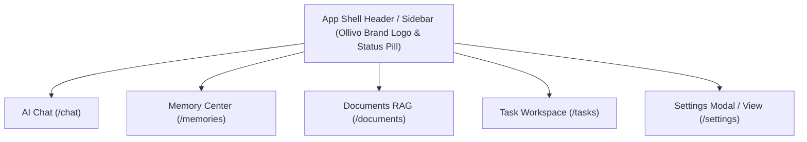

# Ollivo UI/UX Specification & Design System

> **Document Version:** 1.0.0  
> **Status:** Draft Proposed for Approval  
> **Target Platforms:** Web, Android, iOS, macOS  
> **Design Philosophy:** Cohesive, polished, usable, high-contrast, local-first workspace  

---

## 1. Screen Inventory (Web & Desktop)

On Web and Desktop (macOS / Windows / Linux), Ollivo utilizes a **permanent left-hand sidebar** and an **adaptive multi-column workspace layout**.

| Screen Name | Route / View | Layout Pattern | Core UI Components |
| :--- | :--- | :--- | :--- |
| **AI Chat Workspace** | `/chat` | 2-Column (Sidebar + Centered Chat Stream) | Model connection badge, message thread, streaming indicator, markdown code blocks, input bar with action buttons. |
| **Memory Management Center** | `/memories` | 2-Column (Sidebar + Grid/List Content) | Search bar, category filter pills, memory card grid, "Forget Fact" button, "Clear All Memories" alert button. |
| **Documents & Local RAG** | `/documents` | 2-Column Split (File List + Document Detail Preview) | File drag-and-drop zone, indexed document cards, chunk statistics badge, document query box. |
| **Task Workspace** | `/tasks` | 2-Column (Sidebar + Interactive Task List) | Quick task entry input, filter tabs (All, Active, Completed), task cards with priority badges and checkboxes. |
| **Settings & Diagnostics** | `/settings` | 2-Column (Sidebar + Settings Card Sections) | Ollama host configuration field, active model selector, local storage meter, dark/light mode toggle. |

---

## 2. Screen Inventory (Android & iOS Mobile)

On Mobile (Android & iOS), Ollivo utilizes a **bottom navigation bar** (Material 3 / Cupertino style) with full-screen views and touch-friendly navigation.

| Screen Name | View Mode | Mobile Adaptation | Touch Targets & Gestures |
| :--- | :--- | :--- | :--- |
| **Mobile Chat** | Primary Tab 1 | Full-width message thread, sticky bottom chat bar with voice/attachment icons. | Swipe left to view chat info, tap code block to copy. |
| **Mobile Memory Center** | Primary Tab 2 | Single-column scrollable cards with top sticky search bar. | Swipe right on memory card to delete/forget fact. |
| **Mobile Documents RAG** | Primary Tab 3 | Compact document list with FAB (Floating Action Button) to pick files. | Tap document to expand chunk viewer and summary. |
| **Mobile Tasks** | Primary Tab 4 | Vertical task checklist with quick add floating button. | Tap checkbox to toggle status, long-press to edit task. |
| **Mobile Settings** | Header Action | Full-screen modal sheet accessed via app bar settings gear icon. | Form switches, modal sheets for host URL configuration. |

---

## 3. Navigation Architecture



* **Desktop / Web (width ≥ 900px):** Permanent Left Navigation Rail (Collapsible to icons-only at 900px-1100px).
* **Tablet (600px ≤ width < 900px):** Navigation Drawer / Rail with top header status bar.
* **Mobile (width < 600px):** Fixed 4-item Bottom Navigation Bar (`Chat`, `Memories`, `Docs`, `Tasks`) + Top App Bar featuring the **Ollivo Logo** and **Ollama Connectivity Pill**.

---

## 4. Primary User Flows & Interaction States

### Flow 1: Chatting & Automatic Memory Capture
1. User types prompt in Chat input: *"Remember that our primary color is Emerald #6B9E78."*
2. User presses `Enter` or taps **Send**.
3. Input field clears; user message appears aligned right in an Onyx card.
4. Three-dot pulse animation appears as local Ollama streams response.
5. Ollivo streams response and displays a subtle green badge: `✦ Memory Saved: Primary color #6B9E78`.
6. Tapping the badge navigates to `/memories` with the new memory highlighted.

### Flow 2: Document Upload & Local Interrogation
1. User clicks **"Upload Notes"** or drops `spec.md` into the Documents tab.
2. Document card displays a loading ring with chunking progress (`Indexing 3/10 chunks...`).
3. Indexing completes; card turns active with a checkmark badge (`Indexed: 10 Chunks`).
4. User clicks **"Query Document"**; pre-populates prompt in Chat with grounded document context.

---

## 5. Responsive Breakpoint Rules

| Device Breakpoint | Screen Width | Layout Adaptation | Sidebar Behavior |
| :--- | :--- | :--- | :--- |
| **Mobile Compact** | `< 600px` | Single-column full width, Bottom Navigation Bar. | Hidden; replaced by Bottom Nav Bar. |
| **Tablet Medium** | `600px - 899px` | Adaptive 2-column flex layout, Top Header Bar. | Collapsible Navigation Drawer. |
| **Desktop Expanded** | `≥ 900px` | Fixed 260px Left Sidebar + Multi-column Content. | Permanently visible sidebar with full brand logo. |

---

## 6. Design Tokens & Color Palette

The design system directly adopts the official brand palette extracted from **`OLLIVO LOGO.png`**:

```
                       OLLIVO COLOR PALETTE
┌──────────────────────┬──────────────────────┬──────────────────────┐
│  #121212 (Onyx)      │  #6B9E78 (Emerald)   │  #FFFFFF (Pure White)│
│  Dark Background     │  Primary Brand Accent│  High-Contrast Text  │
└──────────────────────┴──────────────────────┴──────────────────────┘
```

### Color Tokens (Dark Theme Default)
* `color.background.dark`: `#121212` (Onyx)
* `color.surface.dark`: `#1E1E1E` (Charcoal Surface)
* `color.card.dark`: `#252525` (Elevated Card)
* `color.primary`: `#6B9E78` (Olive Emerald)
* `color.primary.dark`: `#558260` (Hover / Active Emerald)
* `color.text.primary`: `#FFFFFF` (Pure White)
* `color.text.secondary`: `#A0A0A0` (Muted Gray)
* `color.border`: `#333333` (Subtle Divider)
* `color.status.success`: `#6B9E78` (Connected / Success)
* `color.status.warning`: `#E6A23C` (Syncing / Caution)
* `color.status.error`: `#F56C6C` (Ollama Offline / Error)

### Color Tokens (Light Theme Fallback)
* `color.background.light`: `#F8F9FA` (Off-White)
* `color.surface.light`: `#FFFFFF` (Pure White Surface)
* `color.primary`: `#6B9E78` (Olive Emerald)
* `color.text.primary`: `#121212` (Dark Onyx Text)
* `color.border`: `#E0E0E0` (Light Gray Divider)

### Typography Tokens
* **Font Family:** `Inter`, `Roboto`, or system default sans-serif.
* **Display Header:** 28px / SemiBold (Tracking: -0.5px)
* **Title H1:** 22px / Medium
* **Body Regular:** 15px / Regular (Line Height: 1.5)
* **Caption / Badge:** 12px / Medium
* **Code / Monospace:** `JetBrains Mono`, `Fira Code`, or `Courier New` (13px / Line Height: 1.4)

### Spacing & Grid System
* `space.xs`: 4px
* `space.sm`: 8px
* `space.md`: 16px (Standard padding)
* `space.lg`: 24px (Card gap)
* `space.xl`: 32px (Section padding)

### Borders & Radius
* `radius.sm`: 6px (Input fields, tags)
* `radius.md`: 12px (Cards, buttons, modals)
* `radius.lg`: 16px (Sidebar, major panels)
* `border.width`: 1px solid `color.border`

---

## 7. Reusable Component Inventory

1. **`OllivoAppHeader`:** Top bar displaying brand logo, view title, and Ollama status pill.
2. **`OllivoSidebar`:** Adaptive left rail navigation for desktop with active tab highlight in `#6B9E78`.
3. **`StatusIndicatorPill`:** Status badge (`Connected` green dot / `Disconnected` red dot) with 1-click reconnect trigger.
4. **`ChatMessageCard`:** User / Assistant chat bubble with markdown rendering, syntax-highlighted code blocks, and copy button.
5. **`MemoryCard`:** Fact memory container with category tag, date timestamp, edit button, and delete icon.
6. **`DocumentDropCard`:** File drop zone and summary view with chunk count indicator.
7. **`TaskRowItem`:** Interactive checkbox row with priority chip (Low/Medium/High) and smooth strikethrough animation.
8. **`PrimaryButton`:** Emerald button (`#6B9E78`) with dark text (`#121212`) and active press feedback.

---

## 8. Accessibility Requirements (WCAG 2.1 AA)

* **Color Contrast:** All text meets minimum contrast ratio of `4.5:1` against `#121212` Onyx background.
* **Touch Target Size:** Minimum `48x48dp` touch targets on mobile devices and `36x36px` clickable elements on desktop.
* **Screen Reader Support:** Semantic headings (`H1`, `H2`), ARIA labels on icon buttons, and explicit live region announcements for streaming AI responses.
* **Keyboard Navigation:** Full keyboard navigation support (`Tab`, `Shift+Tab`, `Enter`, `Esc`, `⌘+N` for new chat, `⌘+K` for search).

---

## 9. States Matrix (Loading, Empty, Error, Success)

```
┌────────────────────────────────────────────────────────────────────────┐
│                          STATE REPRESENTATION                          │
├──────────────┬─────────────────────────────────────────────────────────┤
│ Loading      │ Shimmer skeleton cards & 3-dot pulsing stream animation │
│ Empty        │ Friendly illustration + actionable starting prompt      │
│ Error        │ Inline alert card + clear actionable resolution button │
│ Success      │ Rendered content with subtle emerald confirmation badge │
└──────────────┴─────────────────────────────────────────────────────────┘
```

---

## 10. Consistent Ollivo Brand Logo Usage

To maintain consistent visual branding across all platforms:

1. **Header & Sidebar Placement:**
   * **Desktop Sidebar:** Displays full Ollivo logo asset (Icon + Wordmark) at `36px` height centered in the top left header.
   * **Mobile App Bar:** Displays Ollivo brand icon at `28px` height on the top-left of the App Bar next to the view title.
2. **Splash & Empty States:**
   * Centered Ollivo logo (`64px` height) with a subtle emerald glow backdrop (`#6B9E78` at 15% opacity) on app startup and empty chat screens.
3. **Logo Asset Rule:**
   * The existing `OLLIVO LOGO.png` asset is preserved untouched in project assets (`assets/logo.png`) and rendered using crisp vector/high-DPI scaling rules.

---

## 11. Approval Status

* **Status:** Proposed UI/UX Specification
* **Target File:** `docs/UI_UX_SPEC.md`
* **Next Action:** User review and approval before moving to technical architecture & widget execution.
